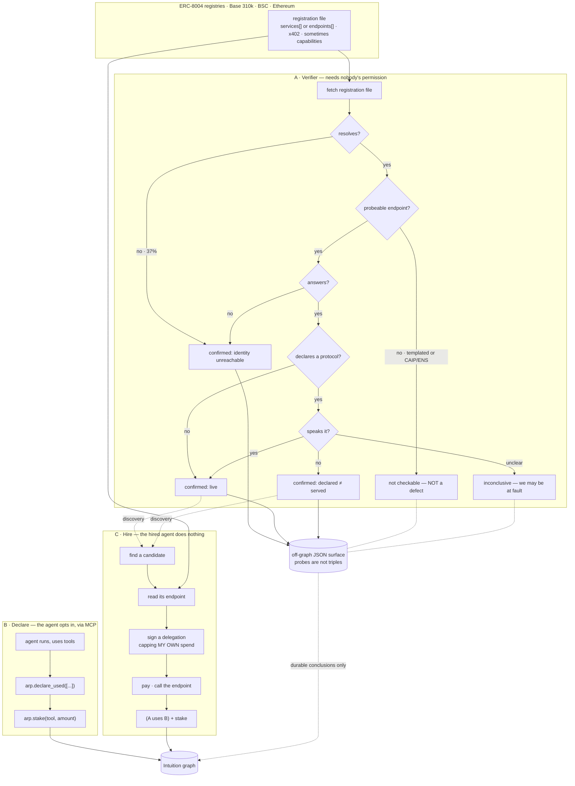

# 13 — The three flows, and the order to build them

**Date**: 2026-10-16
**Serves**: `docs/12_THE_IDEA.md`. Read that first; this is how the mechanism reaches agents that never heard of ARP.

---

## The shape

The arrow that matters: **`RF → A1` needs no consent.** Everything in flow A runs on every agent in
the registry, whether they have heard of ARP or not.

Flow B is narrower, and the gap is the finding. The `uses` edge needs the agent's **identity atom**,
which Intuition's mirror writes, and the mirror holds **28,648** — unchanged since 2026-09-16 while
the registry tripled, so **9.2%** coverage and falling (highest minted id 309,925 on 2026-10-20,
`scripts/measure/cohort-coverage.ts`). For the other nine in ten the atom does not exist and must be
written: `scripts/agent/agent-identity-atom.ts`, ADR `0047`. Every count here moves at ~44,000 agents a
day, so run the script rather than quoting this paragraph.

---

## What each flow costs the agent being rated

|                | Adoption required | Signal strength                          | Starts              |
| -------------- | ----------------- | ---------------------------------------- | ------------------- |
| **A** verifier | **none**          | weak per agent, universal and continuous | immediately         |
| **B** declare  | an MCP endpoint   | medium — costly, therefore credible      | when someone adopts |
| **C** hire     | **none**          | **strongest** — somebody paid twice      | when someone hires  |

A feeds discovery for C. C produces the best signal. B is the optional middle.

---

## Why A comes first

Every plan before this one stalled on the same thing: the graph is empty, and filling it needed
somebody to adopt something. 194 `use` triples against a registry past 309,000.

**A breaks that without asking anyone.** A registration file naming six MCP tools either serves them
or it does not, and finding out is a request anyone may make. The result is a fact about the agent
that the agent published itself — the same move as checking an EIP-712 signature nobody checks.

It is also the only signal that **moves on its own**. Liveness changes when an endpoint goes down;
capability truth changes when a deployment drifts from its manifest. That is what makes the ratings
dynamic rather than a snapshot, and what gives a market something to price.

---

## The plan

### Phase 1 — the verifier

A worker that walks the cohort, reads each registration file, probes the declared endpoints, and
records two facts per agent: does it answer, and does it serve what it claims.

Hard parts, named now:

- **Most declared endpoints cannot be probed at all**, and that is not their fault. Measured over
  n = 140 random ids on 2026-10-16: of 90 declared endpoints, 76% carry an unsubstituted
  `{placeholder}` and 7% are a CAIP address or ENS name rather than a URL. **Only 16 of 90 were
  probeable.** Those 82% must report _not checkable_, never _failing_ — get this wrong and the
  verifier mass-slanders the cohort on its first run. **The share is not stable**: on 2026-10-27 it
  was 4% of 186 endpoints, because a uniform sample of a registry one operator minted most of is a
  sample of that operator (ADR `0064`). The rule is the part that holds; the proportion is not.
- **The volume is in the document layer, not the endpoint layer.** 23% of sampled ids have no
  `tokenURI`; of those that do, **37% publish a registration file that does not resolve**. One GET
  establishes it — the cheapest and most abundant confirmed fact available.
- **Two spellings coexist**, and the common one is not the one the examples use: `services[]` 106
  occurrences against `endpoints[]` 2. A verifier reading only `endpoints` sees almost nothing — a
  real bug while measuring, and the first thing to get right.
- **A declared protocol is where the check gets sharp.** Of 4 endpoints named `mcp`, 2 answer
  `initialize` correctly and 2 do not. Clawnch declares six MCP tools and a standard client gets
  `{"error": "Missing sessionId query parameter"}` and zero tools. But a prober must separate _"the
  agent is broken"_ from _"we spoke the protocol wrong"_ and say which.
  **Reporting a false defect is this component's version of a false `mismatch`**, and the connector's
  rule applies unchanged: when unsure, say unverified, never accuse.
- **Rate and courtesy.** Probing 300,000-plus third-party endpoints is a load somebody else pays for. Back
  off, cache by document hash, identify the client, honour `robots`-equivalent signals. Limit per
  host, not globally: Termix alone accounts for 38 of 108 endpoints in the sample, so a global limit
  still hammers one host.
- **Where results live.** Off-graph first — a published JSON surface like the trust-assessment
  resolver. Writing every probe on-chain is unaffordable and wrong: liveness changes hourly, and
  `docs/07`'s named anti-pattern is mutable data as triples.

**Gate**: liveness and endpoint classification for 100 agents, reproducible from a committed script,
with the _not checkable_ and _we might be wrong_ cases visibly separated from the confirmed facts. A
reviewer must be able to take any confirmed row and reproduce it with one `curl`.

Full spec and the measured table: `docs/tasks/17-the-external-verifier.md`.

### Phase 2 — hire

`scripts/agent-server.ts` already signs a leaf delegation chained off a root and validates fees.
What is missing is hiring an agent that never signed anything: read its endpoint from the registration
file, cap your own spend, pay, call, then `(A, uses, B)` + stake.

**Gate**: one real hire of a cohort agent that has no relationship with ARP, and a stake placed after.

### Phase 3 — the MCP server

Three or four tools: `declare_used`, `stake`, `find_agents`, `hire`. Universal, because any MCP client
connects with no integration work. A web surface for agents that do not speak MCP is the same server
with a form in front.

Deliberately last. It is the flow that depends on someone else choosing to adopt, and Phases 1 and 2
make that choice attractive by having data already.

**Gate**: an external agent declares a tool through MCP without reading this repo.

---

## What stays true throughout

ARP is never in the path of a request. The verifier reads what agents publish. The connector is a node
the operator runs, not a host they depend on, and it holds no key (ADR `0045`). The hire bounds the
buyer, never the seller.

If a design step needs visibility into execution, it is the wrong step — `docs/12`'s drift list says so
and it has been right every time.
