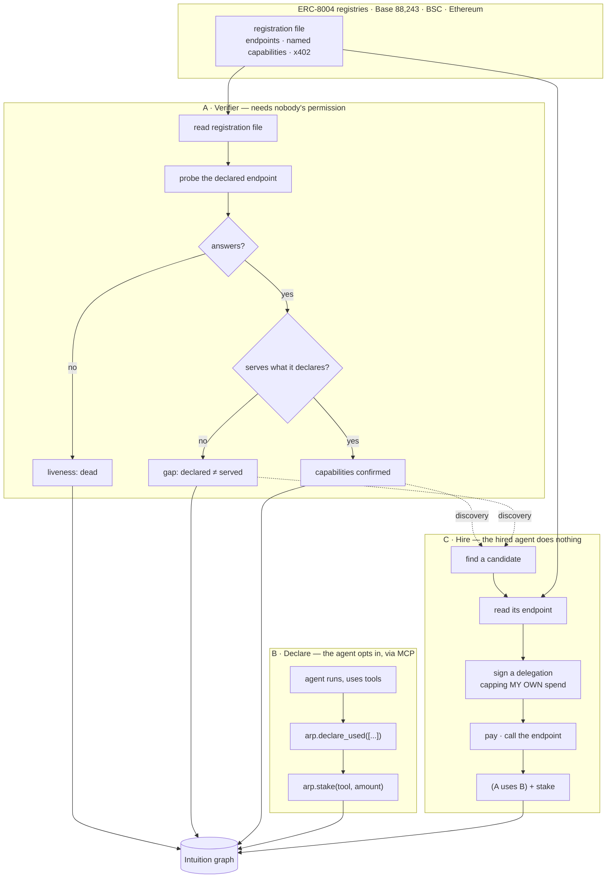

# 13 — The three flows, and the order to build them

**Date**: 2026-10-16
**Serves**: `docs/12_THE_IDEA.md`. Read that first; this is how the mechanism reaches agents that never heard of ARP.

---

## The shape

The arrow that matters: **`RF → A1` needs no consent.** Everything in flow A runs on 88,243 agents
whether they have heard of ARP or not.

---

## What each flow costs the agent being rated

|                | Adoption required | Signal strength                     | Starts              |
| -------------- | ----------------- | ----------------------------------- | ------------------- |
| **A** verifier | **none**          | weak, but universal and continuous  | immediately         |
| **B** declare  | an MCP endpoint   | medium — costly, therefore credible | when someone adopts |
| **C** hire     | **none**          | **strongest** — somebody paid twice | when someone hires  |

A feeds discovery for C. C produces the best signal. B is the optional middle.

---

## Why A comes first

Every plan before this one stalled on the same thing: the graph is empty, and filling it needed
somebody to adopt something. 194 `use` triples against 88,243 agents.

**A breaks that without asking anyone.** A registration file naming six MCP tools either serves them
or it does not, and finding out is a request anyone may make. The result is a fact about the agent
that the agent published itself — the same move as checking an EIP-712 signature nobody checks.

It is also the only signal that **moves on its own**. Liveness changes when an endpoint goes down;
capability truth changes when a deployment drifts from its manifest. That is what makes the ratings
dynamic rather than a snapshot, and what gives a market something to price.

---

## The plan

### Phase 1 — the verifier

A worker that walks the cohort, reads each registration file, probes the declared endpoints, and
records two facts per agent: does it answer, and does it serve what it claims.

Hard parts, named now:

- **Endpoint shapes vary.** MCP needs an `initialize` handshake; some deployments add their own
  requirements. Probed live on 2026-10-16: Clawnch declares six MCP tools, and a standard client gets
  `{"error": "Missing sessionId query parameter"}` and zero tools. That is a real gap — but a prober
  must distinguish _"the agent is broken"_ from _"we spoke the protocol wrong"_, and must say which.
  **Reporting a false gap is this component's version of a false `mismatch`**, and the connector's rule
  applies: when unsure, say unverified, never accuse.
- **Rate and courtesy.** Probing 88,243 third-party endpoints is a load somebody else pays for. Back
  off, cache, identify the client, honour `robots`-equivalent signals where they exist.
- **Where results live.** Off-graph first — a published JSON surface like the trust-assessment
  resolver. Writing every probe on-chain is unaffordable and wrong: liveness changes hourly, and
  `docs/07`'s named anti-pattern is mutable data as triples.

**Gate**: liveness and capability-conformance for 100 agents, reproducible, with the "we might be
wrong" cases separated from the confirmed gaps.

### Phase 2 — hire

`scripts/agent-server.ts` already signs a leaf delegation chained off a root and validates fees.
What is missing is hiring an agent that never signed anything: read its endpoint from the registration
file, cap your own spend, pay, call, then `(A, uses, B)` + stake.

**Gate**: one real hire of a cohort agent that has no relationship with ARP, and a stake placed after.

### Phase 3 — the MCP server

Three or four tools: `declare_used`, `stake`, `find_agents`, `hire`. Universal, because any MCP client
connects with no integration work. A web surface for agents that do not speak MCP is the same server
with a form in front.

Deliberately last. It is the flow that depends on someone else choosing to adopt, and Phases 1 and 2
make that choice attractive by having data already.

**Gate**: an external agent declares a tool through MCP without reading this repo.

---

## What stays true throughout

ARP is never in anyone's runtime. The verifier reads what agents publish. The MCP server is a tool an
agent chooses to call. The hire bounds the buyer, never the seller.

If a design step needs visibility into execution, it is the wrong step — `docs/12`'s drift list says so
and it has been right every time.
