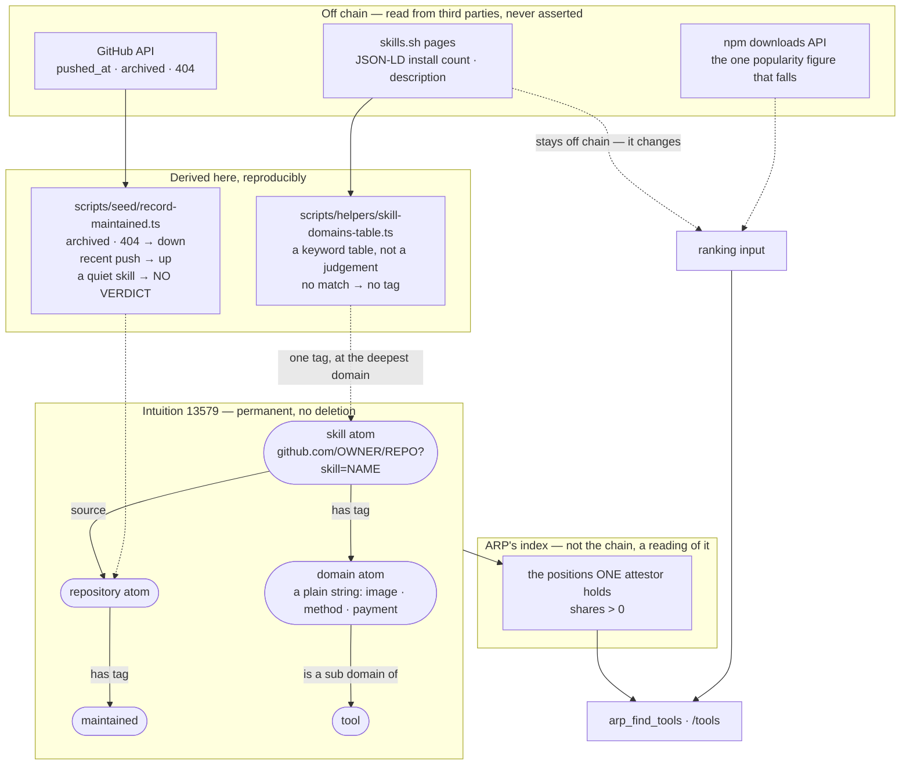

# 20 — What a skill looks like on chain

Written 2026-10-29, after 662 skills, 662 `source` edges and ~530 `has tag` edges went onto
Intuition testnet 13579. It is the map of what is written, what is deliberately **not** written,
and which line separates them.

`docs/25_THE_DOMAIN_TREE.md` is the domain tree's theory. This is the thing that got built on top of it.

## 1. The whole picture



## 2. The line, in one sentence

**A fact goes on chain when it is the owner's own word or a thing we called; a figure that moves
stays off it.**

|                               | on chain | why                                                                       |
| ----------------------------- | -------- | ------------------------------------------------------------------------- |
| `archived`, a 404             | yes      | the owner's own declaration, and it does not come back                    |
| a recent push                 | yes      | somebody is working on it, whatever the repository holds                  |
| **a long silence on a skill** | **no**   | finished and abandoned look identical, so ARP says nothing                |
| an install count              | **no**   | somebody else's number, it changes, and a copy can out-install its author |
| a domain tag                  | yes      | derived from a committed table a third party can re-run                   |
| **no keyword matched**        | **no**   | 61 of 662 carry nothing. A wrong tag is permanent                         |

**Those 61 are the same 61 the catalogue has no atom id for**, verified 2026-10-29 by
`scripts/measure/catalogue-atom-ids.ts` — one gap seen from two sides, not two gaps. Their **atoms
do exist on chain**, all 61, so `resolveInvocations` reports them `unrecorded` rather than unknown
(ADR `0080`). A reader should not take "unrecorded" to mean "untagged": the first is a missing line
in a JSON file, the second is the tagger declining to guess, and `counts.notTaggedButClassifiable`
is 0 because it declined rather than missed.

The three abstentions are the point. `docs/14` is the argument; this is the table.

## 3. What identifies a skill

```
https://github.com/<owner>/<repo>?skill=<name>
```

The two arguments of `npx skills add <repo> --skill <name>` and nothing else. No request to resolve
it, nothing in it that can move, and the atom id is a pure function of the two strings.

**`…/<repo>#<name>` was the shape that nearly shipped.** `normaliseToolUrl` drops the fragment — a
fragment is a scroll position — so all 55 of one repository's skills would have hashed to the
repository's own atom. One atom for 55 things, permanently, with nothing to notice at write time.
Checked before anything was written. ADR `0077`.

## 4. Why `source` was worth paying for

Measured 2026-10-29 **by content hash**, not by name
(`scripts/measure/skill-content-duplicates.ts`): of **531** distinct SKILL.md files in the
catalogue, **116 exist in more than one repository**.

```
101-skills/superpowers          86 SKILL.md
magentosh/superpowers           86 SKILL.md       all 86 byte-identical
qu-skills/superpowers           86 SKILL.md       across all six, every one
skills-shell/superpowers        86 SKILL.md       of the fifteen pairs
its-a-skill-issue/superpowers   86 SKILL.md
bankai-skills/superpowers       86 SKILL.md

obra/superpowers                15 SKILL.md       ZERO shared with any of them
```

> **Corrected 2026-10-29.** This said the six were "copied from `obra/superpowers`" and that "two
> of the copies out-install the original". **Both are false.** It shares no file with any of them
> and is a different project carrying the same repository name. The shared _name_ was read as
> evidence of shared content; only a hash is. `claims.md` §3 — a claim about a third party needs a
> source, and a repository name is not one.

The copy finding survives the correction and is stronger for being measured: GitHub's blob sha is
`sha1("blob " + length + "\0" + content)`, so **anyone can reproduce it** with
`git hash-object SKILL.md` and no credential at all. That is `docs/14`'s test met exactly.

**An install count cannot tell any of this apart.** It is somebody else's number and it ranks
nothing it can verify. The `source` edge does not settle who was first either — a fork's `source`
points at the fork — but it makes the question askable, which it was not before.

## 5. The index is a reading, not the chain

Anyone may write `(anything, has tag, anything)`; Intuition is permissionless and that is the
feature. So the chain is not an index, and ARP does not try to make it one.

**ARP's index is the set of triples one chosen address holds a position in**, `shares > 0`
(`packages/protocol/src/domains.ts`). That address is a property of the **node**, never of the
request — an agent cannot widen its own scope by asking.

Two consequences worth stating together, because the second is what makes the first bearable:

- Everything ARP asserts **costs something**, and the cost is what makes it attributable.
- **Everything ARP asserts can be withdrawn.** Redeeming the position removes the claim from the
  index and returns the stake less the exit fee. The triple stays on chain, unowned and unasserted
  — which is the honest record: ARP said it, then stopped.

That second property was used the day it was built. A keyword table ordered general before specific
wrote ~203 tags that were wrong — `blockchain` matched `token` in "cuts token usage" and in
"design tokens" — and they were retired by `scripts/verify/audit-skill-tags.ts`, which reads what ARP
actually holds from the indexer rather than replaying the table that wrote it. **A script that
audits its own memory of what it wrote cannot find a write it forgot**, and that one found 528
skill tags where the send log accounted for 296.

## 6. What is on chain today

Measured on testnet 13579, 2026-10-29. Re-derive with `scripts/verify/audit-skill-tags.ts`.

|                                   |                                                                        |
| --------------------------------- | ---------------------------------------------------------------------- |
| skill atoms, pinned               | 662                                                                    |
| `source` edges                    | 662                                                                    |
| `has tag` edges on skills         | ~530 written, 203 retired, the remainder pending                       |
| `maintained` tags on repositories | 53 — 50 alive, 3 not                                                   |
| domains under `tool`              | 21 routable, `method` · `writing` · `image` · `audio` · `document` new |
| skills carrying no tag            | 61 — nothing matched, so nothing is claimed                            |

## Evidence ladder

This serves the **staked** rung: a tag is a paid, attributable claim, and a term with no position
on it is on the chain without being in anyone's index. It moves ARP up it by making 662 skills
findable rather than merely written — with the caveat §5 records, that a _wrong_ staked claim is
worse on that ladder than no claim at all, which is why the retirement path was built before the
tagging was finished rather than after.
