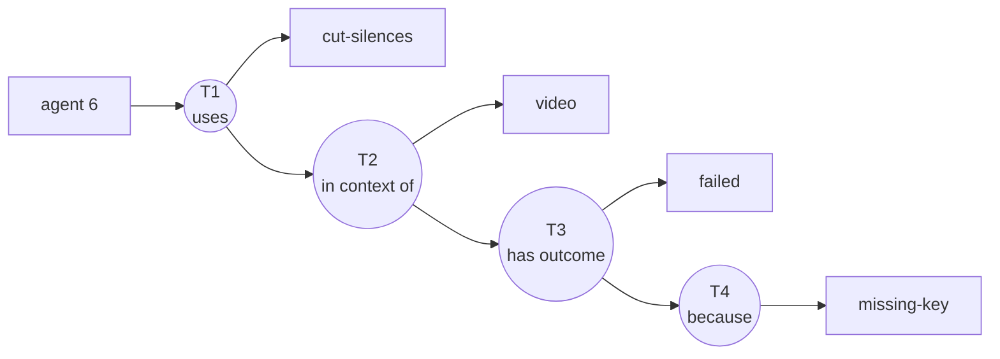
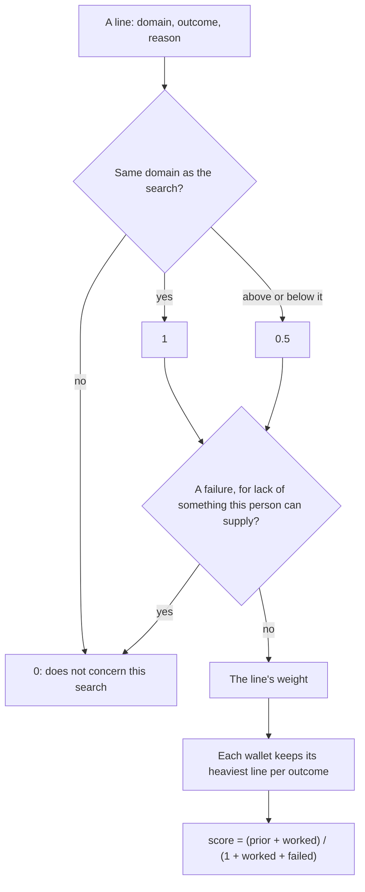

# 28 — The signal: from a line on chain to a place in a search

**Status:** the shape and the reasons are decided (ADR `0138`). The weights are first guesses, and what they are worth is in `docs/tasks/66`.
**Date:** 2026-11-05

The product is the search (ADR `0136`). A declaration is its fuel. This document says how a declaration is written, and what each part of it does to the next search.

## How a line is written

Form B: each triple is the subject of the next one. The same sentence always gives the same id, so two agents who write it speak about the same term.



A round is a triple, a rectangle is an atom. An arrow from a round to a round means that the second is about the first.

```
T1 = (agent 6, uses, cut-silences)
T2 = (T1, in context of, video)
T3 = (T2, has outcome, failed)
T4 = (T3, because, missing-key)
```

This sentence is on testnet 13579 (`data/measurements/pulse-walk-2026-11-05.jsonl`, form B).

**A line can stop at any level**, and each level costs one more fee. With no domain, the outcome is about T1.

**Closed words.** A domain is a category that already exists under `tool`. An outcome is `worked` or `failed`. A reason follows only a failure:

| Reason | Says |
| --- | --- |
| `missing-key` | It needed a key the agent did not have |
| `missing-program` | It needed a program the agent did not have |
| `missing-file` | It needed a file the agent did not have |
| `not-the-right-tool` | It does not do this job |

**A wallet declares a use by writing T1, or by holding a position on it and standing behind a domain or a result on it.** A position alone is support, not a declaration. One T1 can have several declarers, each with its own lines. **A level counts for a declarer who stands behind it**, by creating it or holding a position, and behind each level below it too. Anybody else's goes to `byOthers`, shown and not counted. A wallet that did not create the edge stops counting when it withdraws. One that created it keeps its place, and can take its deposit back. This reading is not tested on chain.

## How a line becomes a value



`prior` comes from the rank in the search, from 0.8 to 0.2. `worked` and `failed` are sums of weights. `not-the-right-tool` counts only in the domain it names, not above or below it.

**Example.** `cut-silences` has one line: `video`, `failed`, `missing-key`. A skill with a prior of 0.5:

| Who searches in `video` | Failed | Score |
| --- | --- | --- |
| Says it can supply a key (`can_provide: ["key"]`) | 0 | 0.50 |
| Says nothing, or has no key | 1 | 0.25 |

**What never counts: the amount deposited.** Rank is not for sale. A line written pays a fee per level. A line held on deposits, where the triples exist, loses about 50 times less on 13579 in small vaults (`scripts/measure/line-cost.ts`), which the user accepted on testnet and which blocks a mainnet port until it is answered. This corrects how `docs/12` reads for the score, and the reader does not ask for an amount.

## What each part is worth, in simulation

`docs/tasks/66`, invented worlds, written by the author of the logic. This shows the logic under its assumptions and nothing about real skills, since nobody outside ARP has written a line.

| Part | Result |
| --- | --- |
| Reading declarations at all | 11 to 22 points above the search alone with honest wallets, 7 with 20 false wallets on each bad skill, in a world whose search noise was set once and not varied |
| Domain proximity | Not shown useful, on the one pair of domains the world holds. Form B is kept because a result belongs to its domain, which this simulation does not test |
| The reason | Not shown useful. A condition worth testing: where the good skills are the ones that need something, +0.6 to +2.7 points, found in an exploratory round |
| The proof, at a weight of 2 | Alone, +4.5 against liars without receipts and -12.1 when they hold receipts. With the other details, -0.4 and -20. **So its weight is 1**, and no receipt is read today |

False wallets cost a plain count about 12 points (77.8% to 65.7%). What `arp_pulse` computes today, domain and reason without proof, was not run against them.

## Open

- **When a proof can weigh more.** A self-hire passes every check (`docs/tasks/65`), so its weight stays 1 until two independent parties can be told from one.
- **Do real skills look like `good-need`?** That decides what the reason is worth, and it can be measured without agents.
- **`has outcome` and `because`** are ARP's words. Nobody else reads them unless they are published.
- **A mainnet port** stays blocked until a writer's control of the agent is proven (ADR `0135`), and until the price of a line held on deposits is answered (ADR `0138`).
